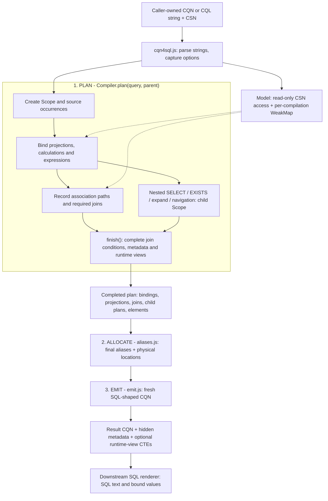
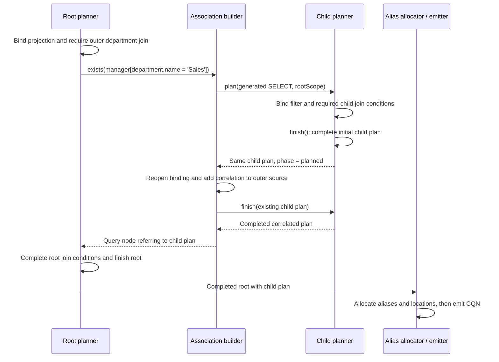

# CQN4SQL compiler rewrite

## Objective and acceptance boundary

Replace the transformation and its private inference machinery with a compiler
that reads caller-owned CQN and CSN, plans each query scope once, and emits fresh
SQL-shaped CQN. Preserve the existing feature set, result metadata, error
contracts, projection order, and deterministic aliases. The baseline includes
current main, especially left joins in expand/EXISTS filters, and the correctness
and ownership regressions from PR #1774.

Completion requires the reference and infer compatibility tests, all local
db-service/SQLite tests, and the remote HANA tests to pass. HANA runs remotely;
the HANA container does not run on this ARM development machine. Existing
reference expectations stay unchanged except where execution demonstrates a
semantic correction. Record every such exception.

## Architecture

The central change is to **keep semantic decisions in a plan until they are
complete, then emit CQN**. A path such as `department.name` first becomes a
binding to a particular source, association and element. Its SQL alias and
physical column name are finalized later. This avoids rewriting reference
strings whenever another part of the query discovers a join.

The normal SQL path in [cqn4sql.js](lib/cqn4sql.js) is literally:

```js
const compiler = new Compiler(model, options)
const result = emit(allocate(compiler.plan(query)))
```

The diagram separates these three operations. The boxes inside planning are
cooperating functions, not independent passes over the entire query.



`cqn4sql` produces SQL-shaped **CQN**, not SQL text. The database renderer still
handles SQL dialects, placeholders, literal conversion and expand rendering.
Metadata-only inference and explicit custom joins take the logical path
described below instead of the allocate/SQL-emission path.

### Step 1: establish ownership and model facts

The entry point parses string input and captures technical-alias, runtime-view
and HANA ranked-search settings. One `Compiler` owns one `Model` wrapper and the
runtime-view registry. All nested scopes in that invocation share these objects.

[model.js](lib/cqn4sql/model.js) reads definitions and derives facts on demand:

- `leaves(element)` flattens structures and managed association keys into
  descriptors such as `{ name, alias, path, element }`. A structured leaf could
  have `name: 'address_city'` and `path: ['address', 'city']`.
- `keyPairs(association)` describes source FK suffixes and target key columns.
  For `department: Association to Departments`, a pair is
  `{ source: 'ID', target: 'ID', path: ['ID'], element: /* ID definition */ }`.
  The association prefix later turns the source name into `department_ID`.
- `primaryKeys(entity)`, `keys(element)`, target lookup and persistence checks
  support correlations, writes and projection decisions.

A `WeakMap` stores facts outside CSN, keyed by the original object. It also caches
serialized filter/argument signatures used for join reuse. The cache lasts for
one compilation, including its nested queries. There is no cross-call cache
requiring model invalidation. In particular, key derivation avoids linked CSN
getters that would memoize by writing onto the caller's model.

The plans themselves are mutable local objects. Input immutability does not mean
copying the plan after every update. It means all SQL planning state belongs to
the compiler, while CQN and CSN are read-only inputs. The public entry point also
reads CDS configuration; it is not a function of just its explicit arguments
independently of that configuration.

### Step 2: create a query scope and its sources

[plan.js](lib/cqn4sql/plan.js) creates a [Scope](lib/cqn4sql/scope.js) for the
query occurrence. It records the operation, input clause, parent scope, source
maps, projection records, joins and result elements. Source-path modifiers are
merged into an owned clause when needed.

A source is an **occurrence**, not just an entity definition. Two aliases of
`Employees` share the CSN definition but have separate source objects and
association trees. A FROM subquery gets a child plan; its result `elements`
become the definition visible through the enclosing source.

`sources` preserves source order, while `sourceNames` supports name lookup.
Qualified references can find sources through the parent scope. Unqualified
references are checked against the current scope's sources, reporting ambiguity
instead of arbitrarily choosing one. `$main`, `$self`/`$projection` and ORDER BY
aliases have explicit lookup rules in the binder.

### Step 3: plan projections and bind their references

[projections.js](lib/cqn4sql/projections.js) first collects explicit columns and
constructs ordered projection records. Maps and sets handle wildcard replacement,
exclusion, duplicate detection and output names without repeatedly searching
the full column list. Ordinary scalar fields found by a root wildcard have a
fast path: their source and element are already known.
Wildcard expansion iterates the model's elements directly, including inherited
elements, without first allocating an array of name/element pairs. Final
projection assembly appends each record's output and checks duplicates in the
same loop, preserving column order without an intermediate flattened array.

`project(scope, record)` computes a record's output on demand and saves it in
`record.output`. If a column refers to `$self.otherColumn`, the dependency is
projected first. `record.active` and `scope.dependencies` track the active
dependency chain and reject cycles. **There is no separately built dependency
graph or repeated whole-list sorting pass.**

[bind.js](lib/cqn4sql/bind.js) resolves each reference into a binding record. It
walks the model path, keeps each encountered element, and records association
traversals. This is where SQL-relevant inference happens: resolving an element
is already necessary to decide whether to flatten, calculate or join it. Its
metadata is retained at that point.

For each association traversal the binder asks whether the requested path is
available through a local foreign key. `department.ID` can use `department_ID`;
`department.name` requires the target row. Filters or arguments can make the FK
shortcut inapplicable. A candidate join can exist without being required.
The binder only derives key pairs for this decision when the reference continues
beyond the association. Selecting the terminal association itself, as wildcard
expansion does, leaves its foreign-key flattening to the projection's leaf
descriptors.

Each source/join has a `children` map. These maps form an association prefix
tree: common traversals reuse the same node under the same source occurrence.
The key includes the path prefix and serialized filter/argument syntax. Thus
different filters, parameters or source occurrences remain separate; this does
not attempt to prove two different predicate expressions semantically equal.
`require(join)` marks the node and its ancestors as needed and records ordering.

A calculated element's CSN `value` expression is bound relative to the current
source/path. The same model expression can therefore produce different bound
occurrences under `a.departmentName` and `b.departmentName`. An active-calculation
set rejects recursion cycles. No bound expression is cached globally on the
model. Virtual fields are omitted unless they carry a calculation, including
the compiler-provided virtual calculations found in draft projections.

### Step 4: bind expressions and introduce nested plans

[expressions.js](lib/cqn4sql/expressions.js) uses the same binder inside functions,
lists and expression token arrays. It preserves operators and explicit grouping,
while lowering constructs such as structured equality into comparisons of
matching leaves. A nested SELECT invokes `plan(syntax, parentScope)` and becomes
a `{ kind: 'query', query: childPlan }` node.

Association behavior is shared through
[associations.js](lib/cqn4sql/associations.js): managed associations use key
pairs; unmanaged conditions bind their ON expressions against explicit source
and target objects. Backlinks recurse through the same condition builder with
cycle detection. The callers retain their different behavior:

| Construct | Planned representation |
| --- | --- |
| Non-key association path | Required join, later emitted as a left join |
| `exists association[filter]` | Correlated child SELECT of `1`; its filter can require its own joins |
| Association expand | Correlated child SELECT with result elements and cardinality metadata |
| Inline projection | More columns in the current scope, bound relative to the inline path |
| Expand with GROUP BY | Validated grouped columns in a `shape` node for nested output |
| Association navigation in FROM | Target source constrained by correlated EXISTS plans |
| UPDATE/DELETE requiring joins | A SELECT plan reusing the bound selection, matched by primary keys |

INSERT/UPSERT retain their write payloads and normalize the target; they do not
turn payload contents into expression trees. UPDATE expressions in `with` use
the common expression binder.

[search.js](lib/cqn4sql/search.js) adds search predicates before clause binding.
Deep association search can generate a key-selecting subquery; HANA ranking can
generate a correlated score subquery. Both enter the same planner. Localization
is a scope/model lookup setting, with separate count-relevance metadata.

### Step 5: complete the plan

Binding columns and clauses discovers required joins. Planning binds their ON
conditions and filters, which can themselves discover further paths.
`finish(scope)` completes outstanding required join conditions, runs conditional
metadata completion, registers runtime views and sets `phase = 'planned'`.

[metadata.js](lib/cqn4sql/metadata.js) completes enum values, casts and localized
count information. It returns immediately when neither type completion nor
localization is needed. Ordinary result elements have already been collected
while binding projections.

[views.js](lib/cqn4sql/views.js) maintains one runtime-view record per definition
in the compiler's `views` map. It plans an owned copy of the view query, detects
cycles and appends views to `viewOrder` after their dependencies. A source keeps
a link to its runtime-view record. The entry point later allocates/emits these
plans as `_with` entries; it does not recompile an already emitted view query.

Generated EXISTS, expand and navigation queries need their correlation attached
after the child source exists. Their initial `plan()` has already called
`finish()`. The caller reopens the child with `phase = 'binding'`, attaches the
bound correlation, then calls `finish()` again. This is completion of the same
plan, not a second `plan()` or a recursive call on SQL-shaped CQN.

### Step 6: finalize aliases and physical locations

[aliases.js](lib/cqn4sql/aliases.js) walks the completed plans. Planning has
provisional names for lookup and ordering; this stage finalizes generated names
using the now-known outer sources, joins and nested queries. Case-insensitive
sets track reservations, and suffix counters resolve collisions deterministically.
Explicit aliases are retained.

The association branches are visited in recorded order. Required nodes form
the final join list. Each ordinary reference receives a `place` record from
`bind.location()`: `{ source, name }`. `source` still points to the source/join
object, and `name` is the physical column name. Emission will read that object's
final alias.
If a binding ends at an association and already carries an expanded leaf, that
leaf supplies the physical foreign-key suffix. `location()` uses it directly
instead of rebuilding key pairs. References that continue through an association
still use key-pair matching to handle renamed and structured keys.

This is why alias changes do not require walking emitted CQN to patch strings.
It also preserves useful FK shortcuts: a root `department.ID` can still read
`e.department_ID` even when `department.name` requires a join elsewhere.

### Step 7: emit owned output and metadata

[emit.js](lib/cqn4sql/emit.js) constructs source CQN, left joins, columns,
expressions and child queries from the finalized plan. It combines correlations
and filters with the necessary grouping. No model reference resolution or join
discovery happens here. The phase guard rejects unfinished plans; `Scope.join()`
also rejects join discovery outside the binding phase.

Physical `column` nodes, including ordinary scalar wildcard columns, return
their fresh reference and hidden element metadata immediately. They bypass the
generic descriptor-copying path, which would create an unused syntax shell for
these nodes. Other node kinds retain descriptor-preserving emission.

[syntax.js](lib/cqn4sql/syntax.js) centralizes syntax ownership. It preserves
query class prototypes and extension descriptors without invoking extension
getters. Caller syntax is not retained as a mutable output prototype. Transient
old inference properties are excluded. Model definitions remain shared metadata;
literal `val` objects, streams and write payloads remain opaque and can retain
identity. Immutability here is a compiler guarantee, not a deep freeze or a deep
clone of application data.

The result carries non-enumerable `_target`, `elements` and column `element`
metadata, plus expand/count flags where needed. Plans keep result elements even
when there is no single entity target. Plain nested query objects keep `SELECT`
as their first own property for compatibility with CDS query-cloning helpers.

### Where inference still fits

SQL lowering no longer invokes the private infer function before transforming
the query. It learns source/element information while planning and retains it.
SQLService and HANAService use `cds.infer.target` at their service boundary.

The private [infer facade](lib/infer/index.js) creates the same compiler with
`metadataOnly: true`, then calls [logical.emit](lib/cqn4sql/logical.js). This
mode resolves logical sources and projections and emits an enriched copy
without physical flattening or association-to-join lowering. It preserves the
repository's infer compatibility contract, which the installed `cds.infer` API
does not yet fully replace.

Explicit custom joins (`from.args`) also select `semanticOnly` mode, inherited
by their child scopes. Their existing syntax is copied and decorated with
metadata rather than passed through normal SQL lowering. Consequently the
rewrite also avoids returning caller-owned syntax in that compatibility path.

### Data structures and their lifetimes

These are small JavaScript records, arrays, maps and sets. The plan is an
internal graph with back-references, not a serializable second CQN format.
The following names are the fields used in the implementation.

| Structure | Main fields | Purpose and lifetime |
| --- | --- | --- |
| `Compiler` | `options`, `model`, `views`, `viewNames`, `viewOrder` | One invocation; shared by every child plan |
| `Model` | `csn`, `cache: WeakMap` | Shared read-only model plus derived facts for this invocation |
| `Scope` | `syntax`, `clause`, `kind`, `parent`, `phase` | One query occurrence; also serves as its query plan |
| Source record | `definition`, `query?`, `requested`, `alias`, `children` | One table/subquery occurrence; links bindings to the correct row source |
| Scope indexes | `sources`, `sourceNames`, `byName` | Maps for source/projection lookup; `elements` is the logical result dictionary |
| Projection record | `syntax`, `name`, `bound`, `element`, `output`, `active` | One requested column; caches its projected output |
| Reference binding | `kind: 'ref'`, `source`, `path`, `steps`, `leaf`, `element`, `calculation?`, `suffix?`, `place?` | One bound reference occurrence; gains its physical location after planning |
| Path step | `name`, `element`, `step`, `join?`, `useJoin?` | Retains model identity and that reference's traversal decision |
| Join node | `parent`, `association`, `prefix`, `step`, `children`, `required`, `order`, `on`, `filter` | Reused candidate traversal under one source; required nodes become SQL joins |
| Expression node | `kind`, `syntax`, `xpr?`, `list?`, `args?`, `element?` | Bound expression children; strings remain tokens in arrays |
| Query / shape nodes | `query` or `columns`, plus result metadata | Child scope or grouped nested output |
| Dependency tracking | `dependencies: Map`, `record.active`, `activeCalculations: Set` | Active recursion chains, removed as binding unwinds |
| Name tracking | `aliases: Set`, `suffixes: Map`; allocation-local sets | Provisional names and final collision avoidance |
| Logical-mode indexes | `columnMetadata`, `subqueries` | Associate syntax with inferred elements/child plans while decorating copies |
| Runtime-view record | `definition`, `alias`, `plan` | Shared by references to that definition within this compilation |

For example, a binding of `department.name` has this simplified shape. `e` and
`departmentJoin` below denote object references, not strings:

```js
{
  kind: 'ref',
  source: e,
  path: ['department', 'name'],
  steps: [
    { name: 'department', element: departmentAssociation,
      join: departmentJoin, useJoin: true },
    { name: 'name', element: departmentNameElement },
  ],
  leaf: departmentNameElement,
  // Added during allocation:
  place: { source: departmentJoin, name: 'name' },
}
```

Emission turns `place` into `{ ref: [departmentJoin.alias, 'name'] }`. By
comparison, a generated physical column uses the smaller
`{ kind: 'column', source, name, element }` record directly. Other node kinds
cover projection aliases (`alias`), projection dependencies (`self`), enum
values (`enum`) and unchanged parameter/pseudo references (`opaque`).

### Worked example: a calculation and a join inside EXISTS

This model illustrates both FK optimization and association filters:

```cds
entity Departments { key ID : Integer; name : String; }
entity Employees {
  key ID : Integer;
  department : Association to Departments;
  manager : Association to Employees;
  departmentName = department.name;
}
```

The input query is:

```cql
SELECT from Employees as e {
  ID, department.ID as departmentID, departmentName
} where exists manager[department.name = 'Sales']
```

The following trace uses `cqn4sql(query, model, false)` for readable generated
names. Default technical aliases differ, but the source identities are the same.

1. The root scope owns the `Employees` source `e`. `ID` binds directly to it.
2. `department.ID` records a traversal but can use the local `department_ID`.
3. `departmentName` binds its calculation `department.name` relative to `e`.
   It requires the department join in the outer scope.
4. `exists manager[...]` creates one child plan selecting `1` from `Employees`.
   The generated source carries the infix filter. In that child, the unqualified
   `department.name` starts at the manager row and requires its own department
   join. It does not refer to the outer employee's department.
5. The child's first `finish()` completes its initial plan. The association
   builder adds `manager.ID = e.manager_ID` using source objects and finishes
   the same child again. For an unmanaged association, binding this correlation can
   discover additional joins before the second completion.
6. Final allocation names the outer join `department` and the child's join
   `department2`, avoiding the already reserved outer alias.
7. Emission produces the equivalent structure shown as SQL below.



```sql
SELECT e.ID, e.department_ID AS departmentID,
       department.name AS departmentName
FROM Employees AS e
LEFT JOIN Departments AS department ON department.ID = e.department_ID
WHERE EXISTS (
  SELECT 1
  FROM Employees AS manager
  LEFT JOIN Departments AS department2
    ON department2.ID = manager.department_ID
  WHERE manager.ID = e.manager_ID AND department2.name = 'Sales'
)
```

This example has **two `plan()` calls**, one for each query scope, and three
`finish()` calls, including the child's correlation completion. There is no
recursive call to the public `cqn4sql` function. Longer EXISTS paths introduce
further child scopes; FROM subqueries, projection subqueries and expands use
the same parent/child relationship. Reusing input syntax in different scope
occurrences does not permit sharing its bindings.

The call counts were checked against the planner. The CQL and displayed SQL
were also executed against the same SQLite rows, including different employee
and manager departments and a null employee department; their results matched.

## Algorithms and performance criteria

- Map lookup for source aliases; element lookup across the current scope's
  sources for unqualified references, with ambiguity detection.
- Ordered projection arrays plus maps for replacement, exclusion, and aliases.
- On-demand dependency evaluation and active-chain cycle detection for `$self`
  and calculations; completed projection records cache their output.
- Association prefix tries with compatible traversal reuse, cached filter keys,
  and monotone foreign-key/join decisions.
- Lazy structures for simple queries. Process each nested query occurrence once.
- Work should scale with syntax, reference lengths, dependencies, and emitted
  output. Do not claim constant cost for expanded output or share bindings
  across different scopes just because the same syntax object was reused.
- Measure transformation separately from parsing, rendering, and execution;
  include ordinary selects as well as wide/deep and unmanaged-association cases.

This is not a claim of one traversal or strictly linear runtime. Binding,
conditional metadata completion, allocation and emission do different work.
Unqualified lookup examines the current sources; join allocation sorts sibling
branches by recorded order; wildcard/structure expansion and calculations cost
at least the size of the output they create. The implementation uses JavaScript
recursion, so it is not stack-independent at arbitrary nesting depths.

## Implementation sequence (completed)

1. Capture baseline tests and representative outputs; preserve both current main
   and the prior refactor as reference implementations outside production code.
2. Implement model descriptors, scopes, bindings, ordered projections, and fresh
   emission for scalar/structured queries and managed associations.
3. Complete expressions, calculations, dependencies, unmanaged conditions,
   navigation, EXISTS, inline/expand, subqueries, and write operations.
4. Complete search, localization, runtime views, inference compatibility, and
   result metadata. Remove the old production pipeline rather than retaining a
   fallback that hides unsupported cases.
5. Run the full reference corpus; fix implementations before considering any
   expectation changes. Add execution regressions for discovered semantic bugs.
6. Verify immutable inputs/models, reused queries, scoped calculations, cycles,
   query-occurrence counts, unknown metadata, and opaque payloads.
7. Run local integration suites, remote HANA (including quoted names), lint, and
   representative benchmarks. Record final results and remaining tradeoffs.

## Validation record

The initial acceptance boundary was completed on 2026-10-30 against main at
`c176754c`. Later wildcard measurements and checks are recorded separately
below. The production implementation contains no fallback to either the original
transformer or PR #1774.

### Module boundaries

| Module | Responsibility |
| --- | --- |
| `cqn4sql.js` | Capture options, plan, allocate names, emit queries and CTEs |
| `syntax.js` | Descriptor-preserving syntax copies and opaque payload ownership |
| `model.js` | Per-compilation model facts, flattened leaves, keys and types |
| `scope.js`, `bind.js` | Lexical sources, association tries, reference and calculation binding |
| `projections.js` | Ordered wildcards, replacements, dependencies, inline and expand |
| `expressions.js`, `associations.js` | Expressions, tuple lowering and shared association correlations |
| `plan.js` | Query scopes, navigation, expands and write selection |
| `aliases.js` | Final alias allocation and physical reference locations |
| `metadata.js`, `logical.js` | Conditional type completion and inference compatibility |
| `search.js`, `views.js` | Search/ranking and shared runtime-view CTE planning |
| `emit.js` | SQL-shaped CQN from completed plans |

Mutable state belongs to the compiler and its plans. Input CQN and CSN are never
enriched with SQL state or cached search columns. Emitted syntax is owned by the
result; model definitions remain shared metadata, and literals, streams and write
payloads remain opaque. Query class prototypes and extension descriptors are
preserved. A query is planned once per occurrence; correlation can complete its
join requirements before aliases and physical locations are finalized. Emission
does not resolve model references or discover joins.

At the initial rewrite, the private infer entry point was a 15-line facade over
the same planner in metadata-only mode. SQL lowering does not invoke it.
SQLService and HANAService use `cds.infer.target` at the service boundary; joins
and FROM subqueries retain result metadata without requiring a single entity
target. No external `@sap/cds` files were changed: its installed inference API
does not yet replace all the compatibility behavior covered by this repository's
infer tests.

### Initial test results

All final runs used Node.js v22.23.3.

| Suite | Passed | Skipped |
| --- | ---: | ---: |
| db-service, including cqn4sql references and infer compatibility | 1,182 | 21 |
| SQLite, better-sqlite3 | 857 | 286 |
| SQLite, sql.js | 857 | 286 |
| Remote HANA, full suite | 860 | 293 |
| Remote HANA, quoted-name bookshop | 183 | 15 |

Lint passed with zero errors and seven existing warnings. `git diff --check`
passed. Remote tests used the configured HANA endpoint through VPN, not a local
HANA container. PostgreSQL was outside this first verification boundary.

Local commands:

```sh
CDS_REQUIRES_DB_DRIVER=better-sqlite3 npm test
CDS_REQUIRES_DB_DRIVER=sql.js npm test -w sqlite
npm run lint
```

Thirty added regression cases cover frozen inputs/models, descriptor accessors,
opaque write payloads, per-path and filtered calculations, inline wildcard
execution, nested inference, dependency cycles, a reverse-ordered 200-column
dependency chain, one planning call per nested FROM scope, runtime-view
immutability, and aliased expands used by CDS query cloning.

Only three existing expectations changed:

- Two inline calculation ON conditions now use `department.id =
  self.department_id` instead of `department.id = Employee.department_id`. A
  calculation on an associated employee must read that employee's department.
  Execution regressions with different root/associated rows verify this semantic
  correction.
- The search test now asserts that `__searchableColumns` is absent from the
  model. Its SQL expectation is unchanged.

### Performance and size

#### Original rewrite measurement (`4bedcd4d`)

Transformation timings exclude parsing, model loading, SQL rendering and database
execution. Each implementation received its own model and query, with 200 warmup
calls followed by seven batches of 1,000 calls. Values below are median
microseconds per transformation on this ARM development machine. The baseline
is main at `c176754c`.

| Query | Main `c176754c` | Initial rewrite `4bedcd4d` |
| --- | ---: | ---: |
| Scalar select | 9.7 | 7.8 |
| Root wildcard | 17.0 | 20.5 |
| Association joins | 15.7 | 11.6 |
| EXISTS with association filter | 30.0 | 15.4 |
| Nested expands | 61.2 | 24.3 |
| Calculated columns | 22.9 | 19.1 |
| Wide projection, 200 columns | 302.9 | 211.3 |

Warm root wildcards were about 21% slower in this original measurement. The other
sampled cases improved by 1.20–2.52 times. Main benefits from mutation-based caches
across calls; the rewrite keeps derived facts per compilation so mutable input
models cannot leave stale cross-call results. Subsequent profiling also found
avoidable allocation and key-derivation overhead, addressed by the changes below.
The original 21% figure does not describe the optimized implementation. These
are sampled transformation microbenchmarks, not end-to-end throughput results.

#### Wildcard optimization (`f3c0006b`)

The wildcard benchmark measures the whole compilation, not just the loop that
replaces `*`. For simple projections, creating temporary records, traversing
arrays and handling generic syntax can account for a noticeable part of that
work. Besides per-compilation model facts, profiling identified avoidable work
in projection assembly, physical naming and emission.

The optimization changes three modules within the existing plan/allocate/emit
pipeline:

| Module | Removed work | Preserved behavior |
| --- | --- | --- |
| `projections.js` | Materializing element-entry pairs and separately flattening/filtering output arrays | Inherited elements, projection order, replacements, exclusions and duplicate handling |
| `bind.js` | Deriving traversal key pairs for terminal associations; rebuilding physical mappings when an expanded leaf already supplies the suffix | Key matching for continuing paths, renamed/structured keys, and join decisions |
| `emit.js` | Constructing a generic syntax shell before returning a physical column | Fresh output references, hidden element metadata, and descriptor preservation for other nodes |

There are no new caches across compilations and no changes to input ownership,
alias allocation or the inference boundary.

The following comparison used isolated copies of main at `c176754c`, the rewrite
before optimization at `498b831a`, and the optimization subsequently committed as
`f3c0006b`. It ran on this ARM machine with Node.js v22.23.3. Each variant had its
own linked model and parsed query. After 1,500 warmup calls per case, nine batches
ran with variant order rotated between batches. Batches contained 2,000 calls,
or 700 for the 200-column case. Values are median microseconds per compilation;
parsing, model preparation, SQL rendering and execution are excluded.

The scalar models contain an integer key and 19 or 199 string fields. Books uses
the [bookshop test schema](test/bookshop/db/schema.cds), either linked directly
or flattened with `cds.compile.for.nodejs()`. The wildcard queries select all
columns from those entities. These cases and batch sizes differ from the original
experiment above; compare implementations within each table.

| Query | Main | Before optimization | Optimized | Reduction vs. before |
| --- | ---: | ---: | ---: | ---: |
| Wildcard, 20 scalar columns | 10.72 | 11.10 | 8.33 | 25.0% |
| Wildcard, 200 scalar columns | 79.91 | 83.47 | 58.23 | 30.2% |
| Books wildcard, structured CSN | 15.51 | 20.15 | 16.76 | 16.8% |
| Books wildcard, flat CSN | 16.47 | 17.63 | 12.23 | 30.6% |
| Explicit Books `{ ID, title }` | 8.07 | 5.60 | 5.50 | 1.8% |
| Books association join `{ ID, author.name }` | 11.26 | 7.93 | 6.97 | 12.1% |

The four wildcard cases improve by approximately **17–31% over the previous
rewrite**. The scalar and flat Books cases also beat main in this run. Structured
Books remains about 8% slower than main (16.76 vs. 15.51 microseconds); the
optimization does not eliminate every cost of the new pipeline. The explicit
select and join cases are controls, not evidence of a universal speedup.

After applying the optimization, **1,161 reference/infer tests in 72 suites
passed, with 19 skipped and no expectation changes**. Changed-file lint and
`git diff --check` passed. At `f3c0006b`, the PR's
[Tests (22) check](https://github.com/cap-js/cds-dbs/actions/runs/41439089589/job/125256150580)
and CodeQL checks also passed. These checks supplement the initial validation
record above; no new stakeholder-suite result is recorded here.

#### Production size

At the initial rewrite (`4bedcd4d`), production JavaScript for the cqn4sql entry
point/modules, infer JavaScript and shared utils decreased from **4,796 to 1,543
physical lines**, a reduction of **3,253 lines (67.8%)**. The module descriptions
and calculated-virtual-field fix brought this to 1,595 lines (`391a0dd6`). The
wildcard optimization adds three net lines, bringing the current total to
**1,598 lines: 3,198 fewer than main (66.7%)** at `f3c0006b`. These counts include
blank/comment lines and exclude tests, this document, and the shared
search/service files.

| Production JavaScript | Main `c176754c` | Initial rewrite `4bedcd4d` | With comments and AFC fix `391a0dd6` | Wildcard optimization `f3c0006b` |
| --- | ---: | ---: | ---: | ---: |
| `cqn4sql.js` and `cqn4sql/*.js` | 3,027 | 1,471 | 1,517 | 1,520 |
| `infer/*.js` | 1,592 | 39 | 45 | 45 |
| `utils.js` | 177 | 33 | 33 | 33 |
| **Total** | **4,796** | **1,543** | **1,595** | **1,598** |

### Why this needs less code

Splitting a large function into modules would not by itself reduce its size.
The main saving comes from removing duplicate representations and the code
needed to keep them synchronized. The old entry point cloned the query, called
private `infer()`, then cloned/transformed the inferred query. Inference and
transformation both handled references, calculations, projections and nested
queries. Much of that behavior now shares one set of records and rules.

| Previous work | Replacement |
| --- | --- |
| Infer references/projections, attach `$refLinks`, `$combinedElements` and join state, then interpret those again during transformation | Resolve sources/elements while binding, retain the result on owned plan records, collect output metadata there |
| Separate wildcard/inline/expand processing in inference and SQL transformation | Ordered projection records and a common `columns()` / `project()` implementation, with logical-mode output where needed |
| Re-enter `cqn4sql()` for subqueries, write selections and runtime views, repeating entry-point setup and inference | Child scopes share the compiler/model facts; writes reuse their bound selection; runtime views have a per-definition plan registry |
| Reconstruct calculation paths and source aliases from transformed syntax and reference links | Bind each calculation with an explicit base source/path; keep source identities until emission |
| Multiple helpers flatten structures, managed keys and comparison operands | Shared leaf/key-pair descriptors used by projections, expressions, correlations and physical location resolution |
| Alias lookups and rewrites spread across joins, expands, subqueries and runtime views | A final allocation stage plus links to source/join/view records |
| Copying and preservation rules scattered among transformation helpers | Shared syntax ownership helpers and focused emission functions |

The association prefix tree is a retained idea from the old join tree, not a
new SQL optimization. The simplification is that its nodes are ordinary plan
objects directly referenced by bindings. Similarly, the tiny infer facade does
not mean inference disappeared: its essential work moved into the shared
planner, and logical compatibility behavior remains in `logical.js`.

Compact formatting and less repeated commentary also contribute to physical
line reduction. A 66.7% LOC reduction therefore does not mean 66.7% fewer
operations or prove correctness. The reference/integration results establish
behavior, and the separate timing measurements above show the gains, the later
wildcard improvements and the remaining structured-model gap. The architectural
benefit is that a correction to reference binding, key flattening or correlation
has one common implementation used by several query constructs.
