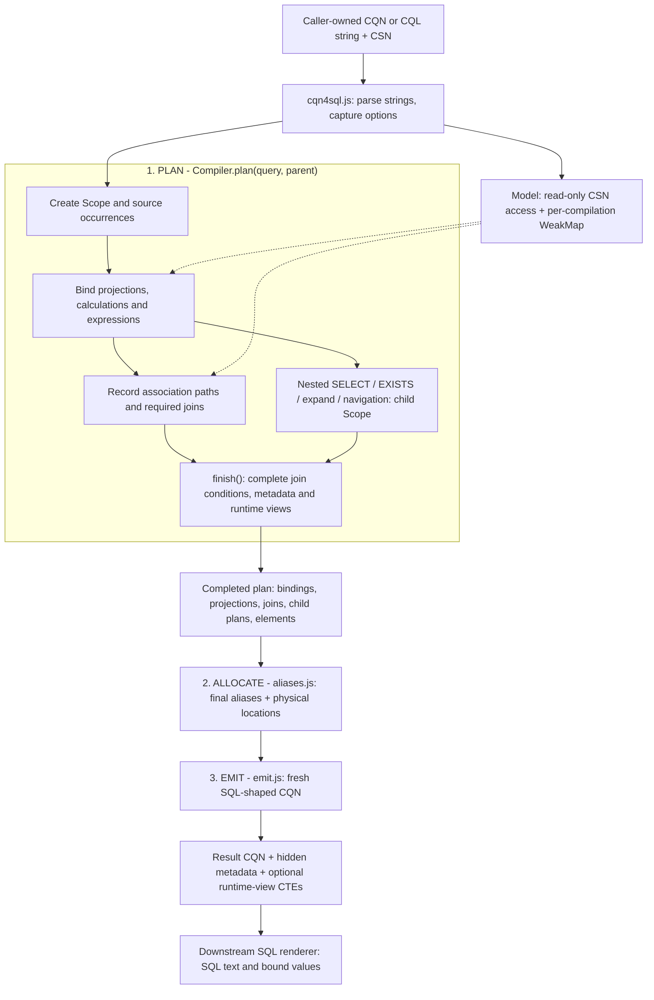
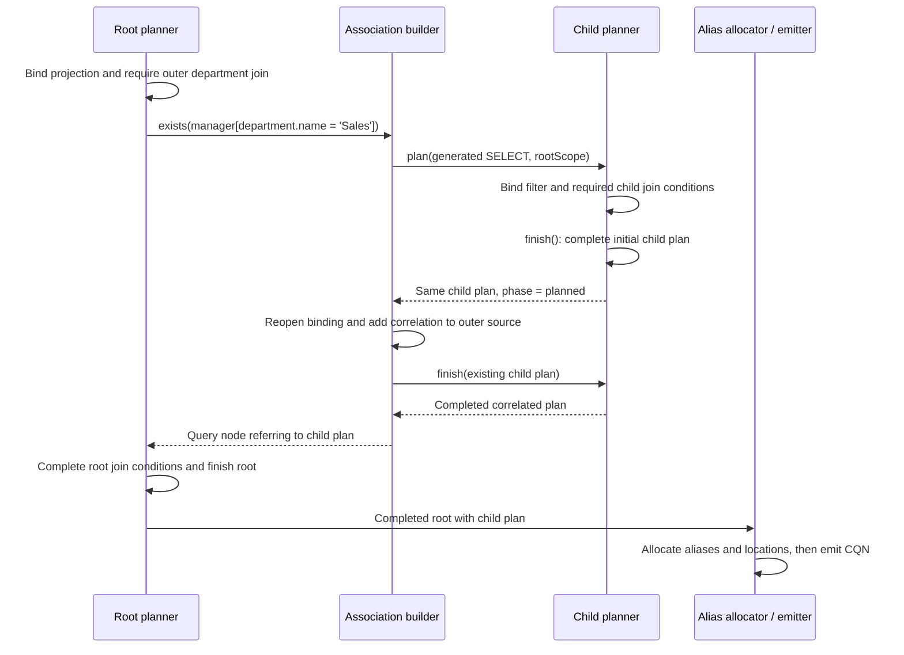

# CQN4SQL compiler

`cqn4sql` compiles CQL or CQN against a CSN model into SQL-shaped CQN. It resolves
references, flattens structures and association keys, plans joins and nested
queries, and returns fresh query syntax with result metadata. Caller-owned CQN
and CSN are read-only inputs.

This guide covers the [compilation pipeline](#compilation-pipeline),
[module responsibilities](#modules),
[data structures](#data-structures-and-their-lifetimes),
[worked examples](#worked-examples) and [algorithms](#algorithms-and-cost).

## Compilation pipeline

The compiler **keeps semantic decisions in a plan until they are
complete, then emits CQN**. A path such as `department.name` first becomes a
binding to a particular source, association and element. Its SQL alias and
physical column name are finalized later. This avoids rewriting reference
strings whenever another part of the query discovers a join.

The SQL path in [cqn4sql.js](../cqn4sql.js) has three stages:

```js
const compiler = new Compiler(model, options)
const result = emit(allocate(compiler.plan(query)))
```

The diagram separates these three operations. The boxes inside planning are
cooperating functions, not independent passes over the entire query.



`cqn4sql` produces SQL-shaped **CQN**, not SQL text. The database renderer still
handles SQL dialects, placeholders, literal conversion and expand rendering.
Metadata-only inference and explicit custom joins take the logical path
described below instead of the allocate/SQL-emission path.

### Step 1: establish ownership and model facts

The entry point parses string input and captures technical-alias, runtime-view
and HANA ranked-search settings. One `Compiler` owns one `Model` wrapper and the
runtime-view registry. All nested scopes in that invocation share these objects.

[model.js](model.js) reads definitions and derives facts on demand:

- `leaves(element)` flattens structures and managed association keys into
  descriptors such as `{ name, alias, path, element }`. A structured leaf could
  have `name: 'address_city'` and `path: ['address', 'city']`.
- `keyPairs(association)` describes source FK suffixes and target key columns.
  For `department: Association to Departments`, a pair is
  `{ source: 'ID', target: 'ID', path: ['ID'], element: /* ID definition */ }`.
  The association prefix later turns the source name into `department_ID`.
- `primaryKeys(entity)`, `keys(element)`, target lookup and persistence checks
  support correlations, writes and projection decisions.

A `WeakMap` stores facts outside CSN, keyed by the original object. It also caches
serialized filter/argument signatures used for join reuse. The cache lasts for
one compilation, including its nested queries. There is no cross-call cache
requiring model invalidation. In particular, key derivation avoids linked CSN
getters that would memoize by writing onto the caller's model.

The plans themselves are mutable local objects. Input immutability does not mean
copying the plan after every update. It means all SQL planning state belongs to
the compiler, while CQN and CSN are read-only inputs. The public entry point also
reads CDS configuration; it is not a function of just its explicit arguments
independently of that configuration.

### Step 2: create a query scope and its sources

[plan.js](plan.js) creates a [Scope](scope.js) for the
query occurrence. It records the operation, input clause, parent scope, source
maps, projection records, joins and result elements. Source-path modifiers are
merged into an owned clause when needed.

A source is an **occurrence**, not just an entity definition. Two aliases of
`Employees` share the CSN definition but have separate source objects and
association trees. A FROM subquery gets a child plan; its result `elements`
become the definition visible through the enclosing source.

`sources` preserves source order, while `sourceNames` supports name lookup.
Qualified references can find sources through the parent scope. Unqualified
references are checked against the current scope's sources, reporting ambiguity
instead of arbitrarily choosing one. `$main`, `$self`/`$projection` and ORDER BY
aliases have explicit lookup rules in the binder.

### Step 3: plan projections and bind their references

[projections.js](projections.js) first collects explicit columns and
constructs ordered projection records. Maps and sets handle wildcard replacement,
exclusion, duplicate detection and output names without repeatedly searching
the full column list. Ordinary scalar fields found by a root wildcard have a
fast path: their source and element are already known.
Wildcard expansion iterates the model's elements directly, including inherited
elements, without first allocating an array of name/element pairs. Final
projection assembly appends each record's output and checks duplicates in the
same loop, preserving column order without an intermediate flattened array.

`project(scope, record)` computes a record's output on demand and saves it in
`record.output`. If a column refers to `$self.otherColumn`, the dependency is
projected first. `record.active` and `scope.dependencies` track the active
dependency chain and reject cycles. **There is no separately built dependency
graph or repeated whole-list sorting pass.**

[bind.js](bind.js) resolves each reference into a binding record. It
walks the model path, keeps each encountered element, and records association
traversals. This is where SQL-relevant inference happens: resolving an element
is already necessary to decide whether to flatten, calculate or join it. Its
metadata is retained at that point.

For each association traversal the binder asks whether the requested path is
available through a local foreign key. `department.ID` can use `department_ID`;
`department.name` requires the target row. Filters or arguments can make the FK
shortcut inapplicable. A candidate join can exist without being required.
The binder only derives key pairs for this decision when the reference continues
beyond the association. Selecting the terminal association itself, as wildcard
expansion does, leaves its foreign-key flattening to the projection's leaf
descriptors.

Each source/join has a `children` map. These maps form an association prefix
tree: common traversals reuse the same node under the same source occurrence.
The key includes the path prefix and serialized filter/argument syntax. Thus
different filters, parameters or source occurrences remain separate; this does
not attempt to prove two different predicate expressions semantically equal.
`require(join)` marks the node and its ancestors as needed and records ordering.

A calculated element's CSN `value` expression is bound relative to the current
source/path. The same model expression can therefore produce different bound
occurrences under `a.departmentName` and `b.departmentName`. An active-calculation
set rejects recursion cycles. No bound expression is cached globally on the
model. Virtual fields are omitted unless they carry a calculation, including
the compiler-provided virtual calculations found in draft projections.

### Step 4: bind expressions and introduce nested plans

[expressions.js](expressions.js) uses the same binder inside functions,
lists and expression token arrays. It preserves operators and explicit grouping,
while lowering constructs such as structured equality into comparisons of
matching leaves. A nested SELECT invokes `plan(syntax, parentScope)` and becomes
a `{ kind: 'query', query: childPlan }` node.

Association behavior is shared through
[associations.js](associations.js): managed associations use key
pairs; unmanaged conditions bind their ON expressions against explicit source
and target objects. Backlinks recurse through the same condition builder with
cycle detection. The callers retain their different behavior:

| Construct | Planned representation |
| --- | --- |
| Non-key association path | Required join, later emitted as a left join |
| `exists association[filter]` | Correlated child SELECT of `1`; its filter can require its own joins |
| Association expand | Correlated child SELECT with result elements and cardinality metadata |
| Inline projection | More columns in the current scope, bound relative to the inline path |
| Expand with GROUP BY | Validated grouped columns in a `shape` node for nested output |
| Association navigation in FROM | Target source constrained by correlated EXISTS plans |
| UPDATE/DELETE requiring joins | A SELECT plan reusing the bound selection, matched by primary keys |

INSERT/UPSERT retain their write payloads and normalize the target; they do not
turn payload contents into expression trees. UPDATE expressions in `with` use
the common expression binder.

[search.js](search.js) adds search predicates before clause binding.
Deep association search can generate a key-selecting subquery; HANA ranking can
generate a correlated score subquery. Both enter the same planner. Localization
is a scope/model lookup setting, with separate count-relevance metadata.

### Step 5: complete the plan

Binding columns and clauses discovers required joins. Planning binds their ON
conditions and filters, which can themselves discover further paths.
`finish(scope)` completes outstanding required join conditions, runs conditional
metadata completion, registers runtime views and sets `phase = 'planned'`.

[metadata.js](metadata.js) completes enum values, casts and localized
count information. It returns immediately when neither type completion nor
localization is needed. Ordinary result elements have already been collected
while binding projections.

[views.js](views.js) maintains one runtime-view record per definition
in the compiler's `views` map. It plans an owned copy of the view query, detects
cycles and appends views to `viewOrder` after their dependencies. A source keeps
a link to its runtime-view record. The entry point later allocates/emits these
plans as `_with` entries; it does not recompile an already emitted view query.

Generated EXISTS, expand and navigation queries need their correlation attached
after the child source exists. Their initial `plan()` has already called
`finish()`. The caller reopens the child with `phase = 'binding'`, attaches the
bound correlation, then calls `finish()` again. This is completion of the same
plan, not a second `plan()` or a recursive call on SQL-shaped CQN.

### Step 6: finalize aliases and physical locations

[aliases.js](aliases.js) walks the completed plans. Planning has
provisional names for lookup and ordering; this stage finalizes generated names
using the now-known outer sources, joins and nested queries. Case-insensitive
sets track reservations, and suffix counters resolve collisions deterministically.
Explicit aliases are retained.

The association branches are visited in recorded order. Required nodes form
the final join list. Each ordinary reference receives a `place` record from
`bind.location()`: `{ source, name }`. `source` still points to the source/join
object, and `name` is the physical column name. Emission will read that object's
final alias.
If a binding ends at an association and already carries an expanded leaf, that
leaf supplies the physical foreign-key suffix. `location()` uses it directly
instead of rebuilding key pairs. References that continue through an association
still use key-pair matching to handle renamed and structured keys.

This is why alias changes do not require walking emitted CQN to patch strings.
It also preserves useful FK shortcuts: a root `department.ID` can still read
`e.department_ID` even when `department.name` requires a join elsewhere.

### Step 7: emit owned output and metadata

[emit.js](emit.js) constructs source CQN, left joins, columns,
expressions and child queries from the finalized plan. It combines correlations
and filters with the necessary grouping. No model reference resolution or join
discovery happens here. The phase guard rejects unfinished plans; `Scope.join()`
also rejects join discovery outside the binding phase.

Physical `column` nodes, including ordinary scalar wildcard columns, return
their fresh reference and hidden element metadata immediately. They bypass the
generic descriptor-copying path, which would create an unused syntax shell for
these nodes. Other node kinds retain descriptor-preserving emission.

[syntax.js](syntax.js) centralizes syntax ownership. It preserves
query class prototypes and extension descriptors without invoking extension
getters. Caller syntax is not retained as a mutable output prototype. Transient
old inference properties are excluded. Model definitions remain shared metadata;
literal `val` objects, streams and write payloads remain opaque and can retain
identity. Immutability here is a compiler guarantee, not a deep freeze or a deep
clone of application data.

The result carries non-enumerable `_target`, `elements` and column `element`
metadata, plus expand/count flags where needed. Plans keep result elements even
when there is no single entity target. Plain nested query objects keep `SELECT`
as their first own property for compatibility with CDS query-cloning helpers.

## Inference compatibility

SQL lowering resolves source and element information during planning. It does
not invoke the private infer function before transforming
the query. SQLService and HANAService use `cds.infer.target` at their service boundary.

The private [infer facade](../infer/index.js) creates the same compiler with
`metadataOnly: true`, then calls [logical.emit](logical.js). This
mode resolves logical sources and projections and emits an enriched copy
without physical flattening or association-to-join lowering. It preserves the
repository's infer compatibility contract, which the installed `cds.infer` API
does not yet fully replace.

Explicit custom joins (`from.args`) also select `semanticOnly` mode, inherited
by their child scopes. Their existing syntax is copied and decorated with
metadata rather than passed through normal SQL lowering. This compatibility
path returns owned syntax as well.

## Modules

| Module | Responsibility |
| --- | --- |
| [cqn4sql.js](../cqn4sql.js) | Capture options, plan, allocate names, emit queries and CTEs |
| [syntax.js](syntax.js) | Descriptor-preserving syntax copies and opaque payload ownership |
| [model.js](model.js) | Per-compilation model facts, flattened leaves, keys and types |
| [scope.js](scope.js), [bind.js](bind.js) | Lexical sources, association trees, reference and calculation binding |
| [projections.js](projections.js) | Ordered wildcards, replacements, dependencies, inline and expand |
| [expressions.js](expressions.js), [associations.js](associations.js) | Expressions, structured comparisons and shared association correlations |
| [plan.js](plan.js) | Query scopes, navigation, expands and write selection |
| [aliases.js](aliases.js) | Final alias allocation and physical reference locations |
| [metadata.js](metadata.js), [logical.js](logical.js) | Conditional type completion and logical inference compatibility |
| [search.js](search.js), [views.js](views.js) | Search/ranking and shared runtime-view CTE planning |
| [emit.js](emit.js) | SQL-shaped CQN from completed plans |
| [infer/index.js](../infer/index.js) | Metadata-only entry point using the same planner |

## Data structures and their lifetimes

These are small JavaScript records, arrays, maps and sets. The plan is an
internal graph with back-references, not a serializable second CQN format.
The following names are the fields used in the implementation.

| Structure | Main fields | Purpose and lifetime |
| --- | --- | --- |
| `Compiler` | `options`, `model`, `views`, `viewNames`, `viewOrder` | One invocation; shared by every child plan |
| `Model` | `csn`, `cache: WeakMap` | Shared read-only model plus derived facts for this invocation |
| `Scope` | `syntax`, `clause`, `kind`, `parent`, `phase` | One query occurrence; also serves as its query plan |
| Source record | `definition`, `query?`, `requested`, `alias`, `children` | One table/subquery occurrence; links bindings to the correct row source |
| Scope indexes | `sources`, `sourceNames`, `byName` | Maps for source/projection lookup; `elements` is the logical result dictionary |
| Projection record | `syntax`, `name`, `bound`, `element`, `output`, `active` | One requested column; caches its projected output |
| Reference binding | `kind: 'ref'`, `source`, `path`, `steps`, `leaf`, `element`, `calculation?`, `suffix?`, `place?` | One bound reference occurrence; gains its physical location after planning |
| Path step | `name`, `element`, `step`, `join?`, `useJoin?` | Retains model identity and that reference's traversal decision |
| Join node | `parent`, `association`, `prefix`, `step`, `children`, `required`, `order`, `on`, `filter` | Reused candidate traversal under one source; required nodes become SQL joins |
| Expression node | `kind`, `syntax`, `xpr?`, `list?`, `args?`, `element?` | Bound expression children; strings remain tokens in arrays |
| Query / shape nodes | `query` or `columns`, plus result metadata | Child scope or grouped nested output |
| Dependency tracking | `dependencies: Map`, `record.active`, `activeCalculations: Set` | Active recursion chains, removed as binding unwinds |
| Name tracking | `aliases: Set`, `suffixes: Map`; allocation-local sets | Provisional names and final collision avoidance |
| Logical-mode indexes | `columnMetadata`, `subqueries` | Associate syntax with inferred elements/child plans while decorating copies |
| Runtime-view record | `definition`, `alias`, `plan` | Shared by references to that definition within this compilation |

For example, a binding of `department.name` has this simplified shape. `e` and
`departmentJoin` below denote object references, not strings:

```js
{
  kind: 'ref',
  source: e,
  path: ['department', 'name'],
  steps: [
    { name: 'department', element: departmentAssociation,
      join: departmentJoin, useJoin: true },
    { name: 'name', element: departmentNameElement },
  ],
  leaf: departmentNameElement,
  // Added during allocation:
  place: { source: departmentJoin, name: 'name' },
}
```

Emission turns `place` into `{ ref: [departmentJoin.alias, 'name'] }`. By
comparison, a generated physical column uses the smaller
`{ kind: 'column', source, name, element }` record directly. Other node kinds
cover projection aliases (`alias`), projection dependencies (`self`), enum
values (`enum`) and unchanged parameter/pseudo references (`opaque`).

## Worked examples

### A calculation and a join inside EXISTS

This model illustrates both FK optimization and association filters:

```cds
entity Departments { key ID : Integer; name : String; }
entity Employees {
  key ID : Integer;
  department : Association to Departments;
  manager : Association to Employees;
  departmentName = department.name;
}
```

The input query is:

```cql
SELECT from Employees as e {
  ID, department.ID as departmentID, departmentName
} where exists manager[department.name = 'Sales']
```

The following trace uses `cqn4sql(query, model, false)` for readable generated
names. Default technical aliases differ, but the source identities are the same.

1. The root scope owns the `Employees` source `e`. `ID` binds directly to it.
2. `department.ID` records a traversal but can use the local `department_ID`.
3. `departmentName` binds its calculation `department.name` relative to `e`.
   It requires the department join in the outer scope.
4. `exists manager[...]` creates one child plan selecting `1` from `Employees`.
   The generated source carries the infix filter. In that child, the unqualified
   `department.name` starts at the manager row and requires its own department
   join. It does not refer to the outer employee's department.
5. The child's first `finish()` completes its initial plan. The association
   builder adds `manager.ID = e.manager_ID` using source objects and finishes
   the same child again. For an unmanaged association, binding this correlation can
   discover additional joins before the second completion.
6. Final allocation names the outer join `department` and the child's join
   `department2`, avoiding the already reserved outer alias.
7. Emission produces the equivalent structure shown as SQL below.



```sql
SELECT e.ID, e.department_ID AS departmentID,
       department.name AS departmentName
FROM Employees AS e
LEFT JOIN Departments AS department ON department.ID = e.department_ID
WHERE EXISTS (
  SELECT 1
  FROM Employees AS manager
  LEFT JOIN Departments AS department2
    ON department2.ID = manager.department_ID
  WHERE manager.ID = e.manager_ID AND department2.name = 'Sales'
)
```

This example has **two `plan()` calls**, one for each query scope, and three
`finish()` calls, including the child's correlation completion. There is no
recursive call to the public `cqn4sql` function. Longer EXISTS paths introduce
further child scopes; FROM subqueries, projection subqueries and expands use
the same parent/child relationship. Reusing input syntax in different scope
occurrences does not permit sharing its bindings.

The employee and manager can belong to different departments. A missing employee
department still preserves that employee row when the manager passes the EXISTS
filter, because the outer department join is a left join.

### Wildcards, foreign keys and exclusions

Using the same model, this query selects the employee's fields while excluding
the manager association from the output:

```cql
SELECT from Employees as e { * } excluding { manager }
```

With readable aliases, its emitted columns are:

```js
[
  { ref: ['e', 'ID'] },
  { ref: ['e', 'department_ID'] },
  { ref: ['department', 'name'], as: 'departmentName' },
]
```

The scalar `ID` becomes a physical `column` node directly. The `department`
association expands to its foreign-key leaf, whose suffix `ID` supplies the
physical name `department_ID`. The binder does not need traversal key pairs for
that terminal association. The calculated `departmentName` independently binds
`department.name`, requiring a left join to `Departments`.

Excluding both associations gives:

```cql
SELECT from Employees as e { * } excluding { department, manager }
```

This removes `department_ID` from the output, but the department join remains:
the selected calculation still needs the employee's department name. Exclusions
control projected fields; they do not remove dependencies of other selected
expressions.

## Algorithms and cost

| Operation | Algorithm | Work that remains |
| --- | --- | --- |
| Source lookup | Maps for qualified names; current-source scan for unqualified names | Qualified lookup can walk parent scopes; unqualified lookup checks ambiguity |
| Reference binding | Walk model path steps, retaining source and element identities | Continuing association paths may compare against multiple key descriptors |
| Model facts | Per-compilation `WeakMap` memoization | Derive encountered leaf/key descriptors and materialize expanded output |
| Projection assembly | Ordered records, maps/sets for names, direct element iteration | Expand wildcards and structures in output order, check duplicates while appending |
| `$self` dependencies | On-demand recursive evaluation with cached projection output | Traverse dependencies; detect cycles using the active chain |
| Calculations | Bind the model expression relative to each source/path occurrence | Different occurrences require different bindings, even for shared syntax |
| Join reuse | Association prefix trees with filter/argument signatures | Serialize each encountered signature once per syntax object; retain distinct traversals |
| Alias allocation | Reserved-name sets, suffix counters, ordered branch traversal | Sort sibling branches by recorded order and finalize physical locations |
| Runtime views | Registry keyed by model definition; recursive dependency planning | Detect cycles and append each view after its dependencies |
| Emission | Walk completed plan nodes and create fresh CQN | Materialize the result syntax and required metadata |

Binding, conditional metadata completion, allocation and emission are separate
traversals with different responsibilities. Overall work depends on syntax size,
path lengths, key comparisons, dependencies and expanded output. A wildcard or
structured projection necessarily costs at least the size of the columns it
emits. The implementation uses JavaScript recursion, so it is not
stack-independent at arbitrary nesting depths.

Several mechanisms keep common queries small: scalar wildcard fields skip
reference-path binding, terminal associations reuse expanded leaf names,
projection assembly avoids intermediate entry/flattening arrays, and physical
columns bypass generic syntax copying during emission. These shortcuts preserve
the same scope, dependency, ownership and metadata rules as other queries.

## Maintaining the compiler

Changes should preserve these boundaries:

- Discover joins while a scope is binding. Complete correlations before final
  alias allocation and emission.
- Keep source/join object identities in bindings until emission. Share model
  facts within a compilation, and bind each query occurrence in its own scope.
- Keep mutable SQL planning state off caller-owned CQN and CSN. Preserve
  descriptors and query prototypes while treating literal and write payloads
  as opaque data.
- Collect result elements while planning and use the logical compatibility path
  where SQL lowering does not apply.

The [reference suite](../../test/cqn4sql/) covers query transformations, and the
[infer suite](../../test/cds-infer/) checks logical metadata compatibility.
[Calculated-element references](../../test/cqn4sql/calculated-elements.test/) cover
scoped calculations and nested queries. Reference tests also compile frozen input
CQN and CSN using [freezeData](../../test/cqn4sql/helpers/freezeData.js);
[API tests](../../test/cqn4sql/API.test.js) cover repeated calls, ownership and
extension accessors. Run the reference and infer suites from the repository
root with:

```sh
node node_modules/.bin/cds-test db-service/test/cqn4sql/ db-service/test/cds-infer/ --timeout 15000
```
